# Inverse Problem Toolbox

## Intro

This toolbox includes many of the more common ill-posed problems, throw a range of
reconstruction methods at it, and actually see why some of them work and others don't. It covers
20 forward problems (deblurring, CT, MRI, compressed sensing, the classic integral equations, and two
nonlinear ones) and 22 methods, from truncated SVD to primal-dual TV/TGV, plug-and-play priors and
posterior sampling. Everything is plain NumPy/SciPy. Every operator is matrix-free with an exact adjoint
and is normalized to ‖A‖₂ = 1, so step sizes and λ values carry over between problems.

You can use the built-in phantoms, or bring your own truth image, your own measured data, or your own
matrix and data vector. The PyQt5 GUI re-solves live as you move a slider, which turns out to be the
fastest way to build intuition for regularization. Hansen's book [1] and Engl, Hanke and
Neubauer [2] are the two references I kept coming back to.

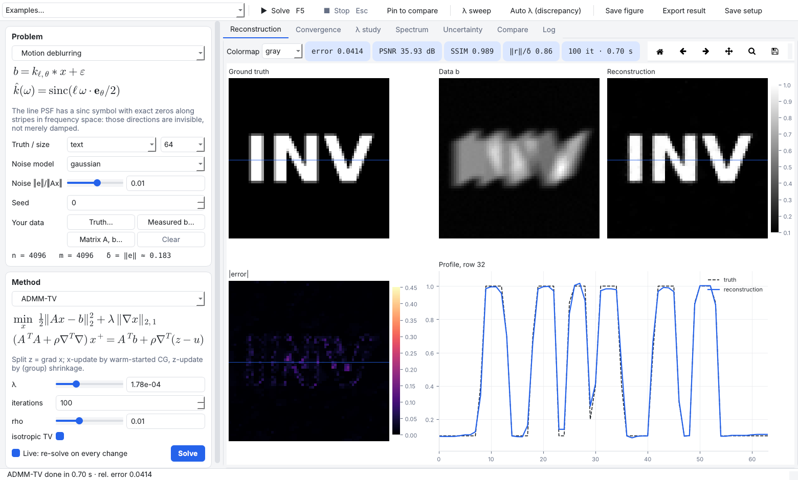

## Install and run

```bash
git clone https://github.com/gaschenb/Inverse-Problem-Toolbox.git
cd Inverse-Problem-Toolbox
pip install -r requirements.txt
pip install -e .
invtoolbox-gui                    # or: python -m invtoolbox.gui      (--dark for the dark theme)
invtoolbox list                   # or: python -m invtoolbox list
python -m invtoolbox.examples.gallery docs/figures                 # regenerate every figure below
python -m invtoolbox.examples.tune                                 # re-derive the default lambdas
```

You need Python 3.10+, numpy, scipy and matplotlib. PyQt5 is only needed for the GUI. There's no LaTeX
dependency: the equations in the GUI are drawn from matplotlib's mathtext as vector outlines.

## Features

1. **20 problems in five families**, each with a choice of size, ground truth (six images, six signals)
   and noise model. They are listed in the table below.
2. **Your own data**, in three ways:
   1. Load an image or signal as the ground truth of any built-in problem. It is resampled to the
      problem grid, and the simulation and all the metrics work as usual.
   2. Load measurements for a built-in forward model, for example a blurred photo or a sinogram. There
      is no truth in that case, so you get the reconstruction, the residual and ‖r‖/δ but no error.
      If you don't give σ, I estimate it from the data with the median absolute deviation of the finest
      wavelet coefficients [3].
   3. Load your own matrix A (dense or sparse) and data b, and optionally a truth to validate against.
      Without σ, the noise level comes from a GCV-tuned Tikhonov fit, σ² = ‖r‖²/(m − tr H) [4].

   Supported files are `.npy`, `.npz`, `.csv`, `.txt`, `.mat`, `.mtx` and images (`.png`, `.jpg`, `.tif`,
   `.bmp`). Measured data are given in the physical units of the un-normalized operator, and I rescale
   them internally.
3. **Noise models.** Gaussian with ‖e‖ ≈ level·‖Ax‖, Poisson photon counts, and salt-and-pepper. The
   expected noise norm δ is tracked for the discrepancy principle.
4. **Parameter choice.** The discrepancy principle [5], L-curve corner [6],
   closed-form GCV [7], quasi-optimality [8], and an oracle when the truth is known.
   Any method can be swept over λ, and iterative methods can stop on the discrepancy.
5. **Analysis.** Picard plots and filter factors from the SVD or Fourier modes [1],
   semiconvergence curves, L-curves, posterior standard deviation maps with credible-band coverage, and
   PSNR / SSIM [9].
6. **Plots that stay on the data.** Pan and zoom are clamped to the full extent of each plot. You can
   zoom in anywhere, but you can't zoom or pan out past the image or the data range.

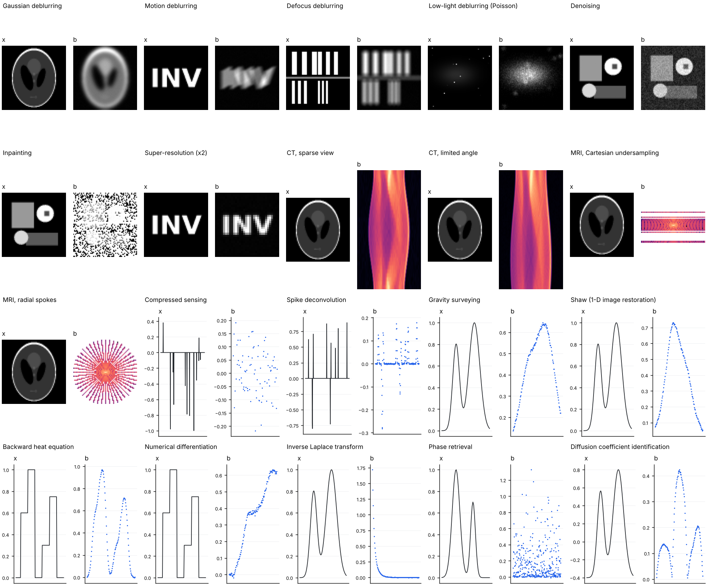

| family | key | forward model | why it is hard |
|---|---|---|---|
| Imaging | `deblur-gaussian` | periodic Gaussian blur | symbol e^(−σ²ω²/2) under the noise floor |
| | `deblur-motion` | 11 px line PSF at 30° | sinc symbol with exact zeros along stripes |
| | `deblur-defocus` | disk PSF | Airy rings of zeros: bar-target contrast reversal |
| | `deblur-poisson` | Gaussian blur, Poisson counts | signal-dependent noise, KL likelihood |
| | `denoise` | identity | the prior does all the work (try salt-and-pepper with an L1 data term) |
| | `inpainting` | pixel mask (70 % missing plus scratches) | null space is the missing pixels |
| | `super-resolution` | blur and 2×2 decimation | 3N²/4-dimensional aliasing null space |
| Tomography | `ct-sparse-view` | parallel-beam Radon, 30 views [10] | streaks, underdetermined |
| | `ct-limited-angle` | 120° wedge | missing Fourier wedge |
| | `mri-cartesian` | variable-density phase encodes [11] | coherent aliasing along one axis |
| | `mri-radial` | radial spokes | incoherent, recoverable with TV |
| Signals | `compressed-sensing` | Gaussian 80×256 [12, 13] | m ≪ n |
| | `spike-deconvolution` | Gaussian blur of spikes | Rayleigh limit |
| Integral equations | `gravity`, `shaw` | Hansen's test kernels [14, 15] | geometric / super-exponential σᵢ decay |
| | `backward-heat` | e^{TΔ} [2] | exponentially severe |
| | `differentiation` | Volterra integration | mild, σₖ ∼ 1/k |
| | `inverse-laplace` | Laplace transform | only a handful of usable modes |
| Nonlinear | `phase-retrieval` | bᵢ = (aᵢᵀx)², m = 6n [16] | nonconvex, sign ambiguity |
| | `coefficient-id` | −(eˣu′)′ = f, 3 sources, adjoint Jacobian | smooths twice, identifiable only where u′ ≠ 0 |

Images are 32² to 128² and signals 64 to 512 samples. But this can easily be changed if you want to. `invtoolbox list` prints the sizes and truths for
each problem. The Shepp–Logan phantom is from [17].

## Methods

Each method is a function `fn(problem, data, ctx, **params)` with a parameter spec, which the GUI and
CLI use, and equations that are rendered in the GUI. Variational methods minimize D(Ax, b) + λR(x).

| group | methods |
|---|---|
| Direct | scaled back-projection Aᵀb, filtered back-projection with Ram-Lak / Shepp-Logan / cosine / Hann filters [10], truncated SVD with k by discrepancy, generalized Tikhonov with L = I, ∇, Δ [18] (FFT closed form, SVD filter, dense solve or CG) |
| Iterative regularization | projected Landweber [19], CGLS [20], SIRT [21], randomized Kaczmarz [22], all with optional discrepancy stopping |
| Sparsity | ISTA [23], FISTA with adaptive restart [24, 25] on pixels or orthonormal Haar / db2 / db4 wavelets [26], ADMM lasso [27], OMP [28], IRLS for ℓᵖ with p < 1 on x or ∇x [29] |
| Total variation | ADMM-TV, isotropic or anisotropic [27, 30], Chambolle–Pock [31] with L2 / L1 / KL data terms and TV / TGV² [32] / ℓ¹ / wavelet-ℓ¹ priors, x ≥ 0, with the FGP TV prox [33] |
| Poisson / EM | Richardson–Lucy [34, 35], optionally with TV [36] |
| Plug-and-play | PnP-ADMM [37] with cycle-spinning wavelet [38], TV, Gaussian or median denoisers |
| Bayesian | Gaussian posterior with exact marginal std for n ≤ 1100 and randomize-then-optimize samples [39] otherwise, and the MYULA Langevin sampler for the TV posterior [40]; see [41] for the background |
| Nonlinear | Levenberg–Marquardt Gauss–Newton [42] with a Laplace-approximation std, L-BFGS-B [43], Wirtinger flow [16], amplitude flow [44], and spectral initialization for phase retrieval |

The default λ for each method and problem is the error-optimal value at that problem's default noise
level (from `examples.tune`). It is rescaled with the noise level: ∝ level² for quadratic priors and
∝ level otherwise. For real work, use the λ-study tab or `--lam discrepancy`.

## Results

1. **Sparse-view CT** (30 views, 2 % noise). TV and TGV² halve FBP's error.

   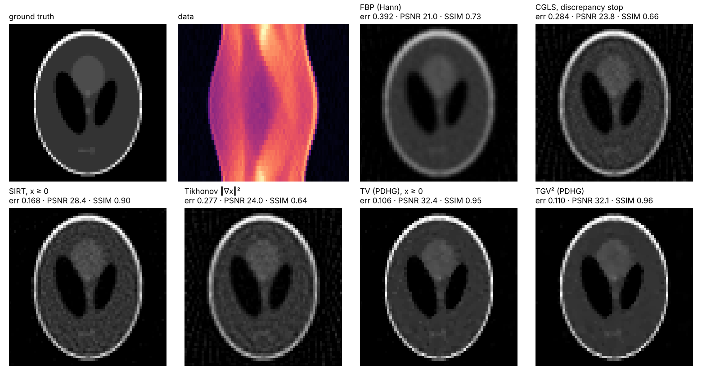

2. **Motion blur.** TV recovers the text almost exactly, while Tikhonov and early-stopped CGLS ring.

   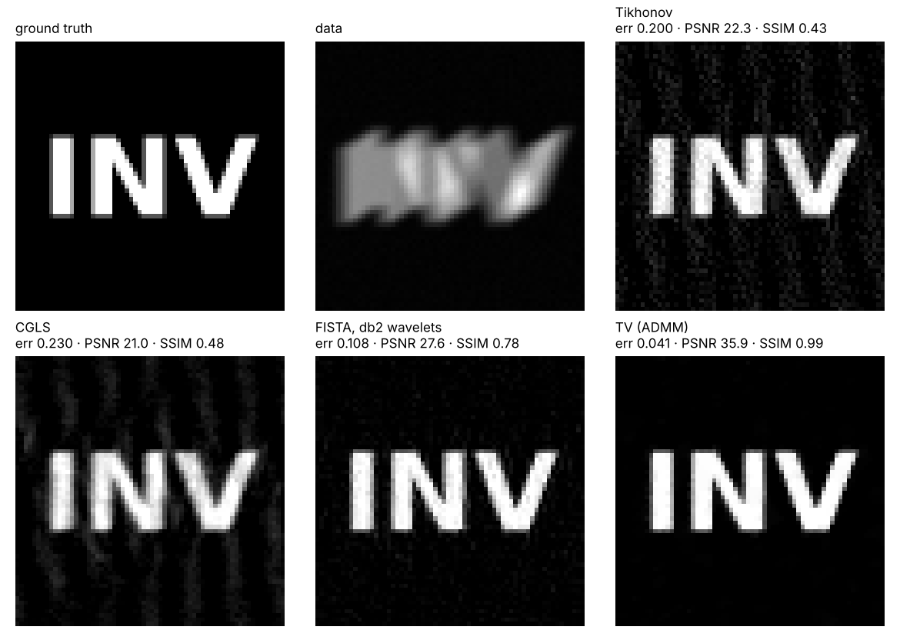

3. **Radial MRI** (37 % of k-space). TV compressed sensing gets to 3.5 % error, from 36 % with zero
   filling [11].

   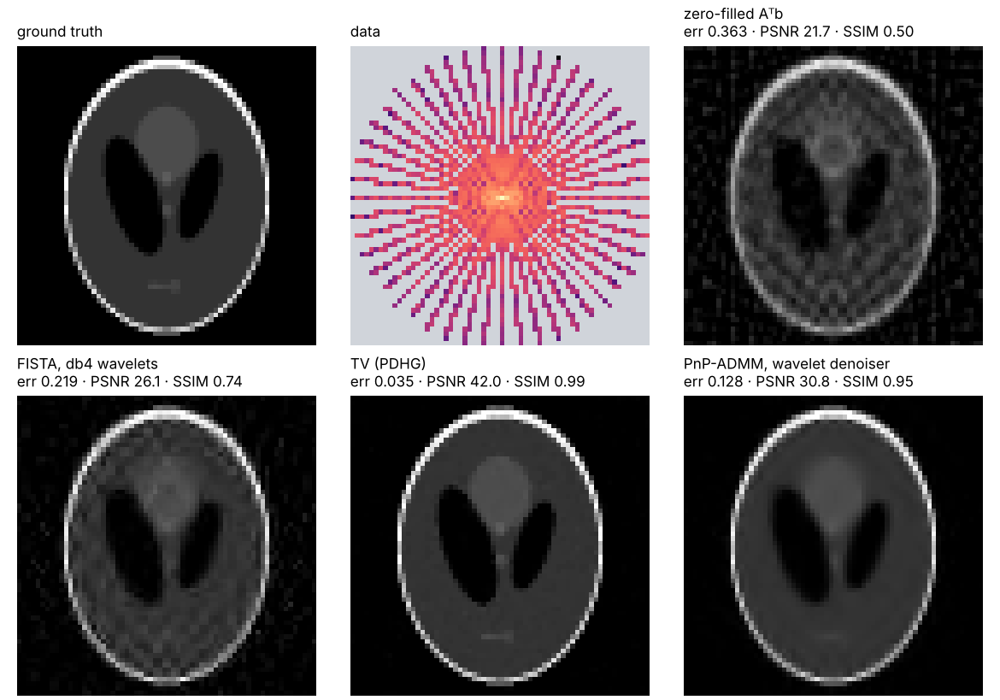

4. **Compressed sensing.** ℓ² spreads the energy everywhere. ℓ¹, OMP and IRLS with p = 0.5 all recover
   the support [12, 13].

   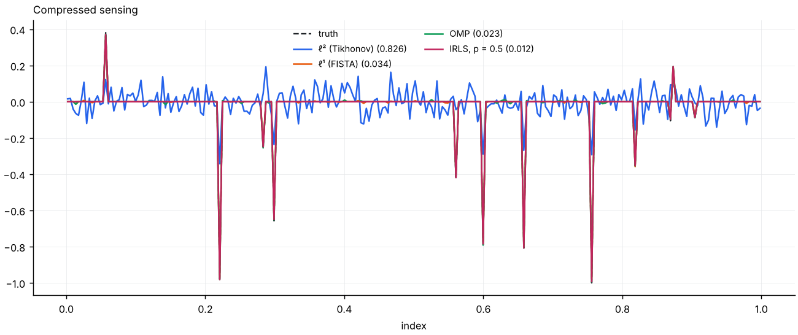

5. **Photon-limited deblurring** (about 100 photons at the peak). Richardson–Lucy with early stopping
   does best on the point sources. KL and L2 data terms with TV come close at this count level.

   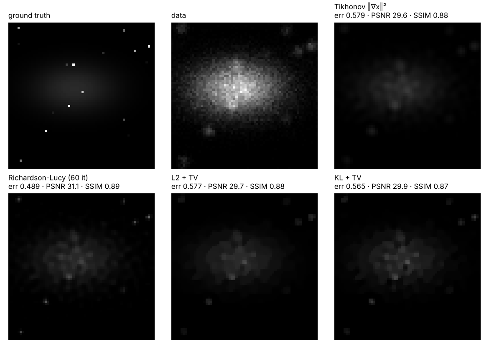

6. **Parameter choice.** On gravity, the discrepancy principle, the L-curve and quasi-optimality land
   within a factor of 5 of the oracle. GCV is known to be flat for geometric σᵢ decay and
   under-regularizes here [1]. The Picard plot on the right shows |uᵢᵀb| hitting the noise
   floor at i ≈ 8.

   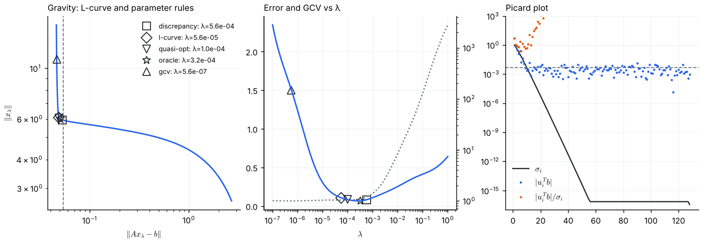

7. **Semiconvergence.** The iteration count acts as the regularization parameter on limited-angle CT
   [2]. The squares mark the discrepancy-principle stopping index.

   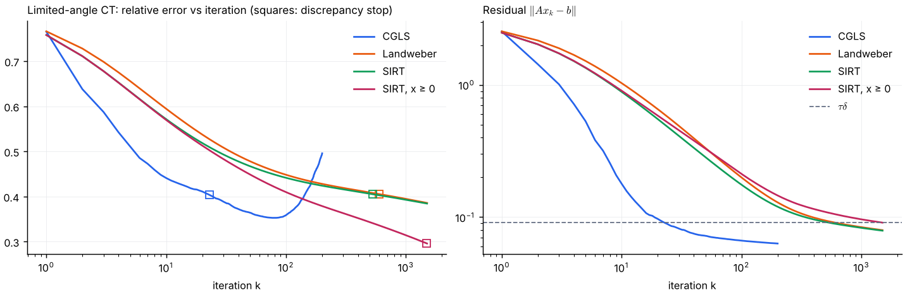

8. **Uncertainty.** From left to right: the exact Gaussian posterior for backward heat, the Laplace
   approximation at the Gauss–Newton MAP for coefficient identification, and the MYULA posterior std for
   a TV prior, which is largest at the edges [40].

   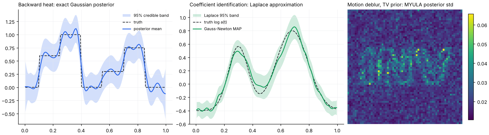

9. **Phase retrieval.** Spectral initialization, followed by Wirtinger flow, amplitude flow or
   Gauss–Newton [16, 44].

   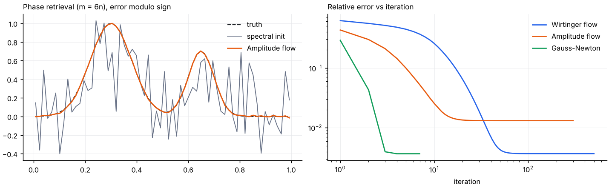

## GUI

Run `invtoolbox-gui`. The left side has the problem and method cards, with the forward model and the
objective rendered in the app, a short note on what makes the problem ill-posed, and controls built
from each method's parameter spec (log sliders for λ). The right side has seven tabs:

1. **Reconstruction.** The truth, the data (sinogram, log k-space, observed pixels, low-res image, or 1-D
   data with the model prediction), the reconstruction, |error|, and a line profile. Click any image to
   move the profile. The chips show relative error, PSNR, SSIM, ‖r‖/δ, iterations and time.
2. **Convergence.** Objective, error and residual against iteration, with the τδ line. Pinned runs are
   overlaid.
3. **λ study.** Sweeps any method over λ. It shows the L-curve coloured by log λ (click a point to use
   it), error and ‖r‖/δ against λ, and GCV where it's available. There are one-click buttons for the
   discrepancy, L-curve, GCV, quasi-optimality and oracle choices. For iterative methods it shows
   semiconvergence and sets the stopping index.
4. **Spectrum.** The Picard plot (SVD or Fourier modes) and the current method's filter factors.
5. **Uncertainty.** Posterior mean, std, |error|/std, and the 95 % credible-interval coverage of the truth.
6. **Compare.** Pinned runs in a sortable table, with an image gallery or overlays and error histories.
7. **Log.**

The **Your data** buttons in the problem card load a truth, measured data or a matrix (A, b). With
measured data the noise controls are locked, the truth panel is marked unknown, and the chips show
‖r‖/δ instead of the error. Your truth image stays loaded when you switch problems, so you can run one
picture through every forward model. **Clear** goes back to the built-in data, and **Save setup**
remembers the file paths.

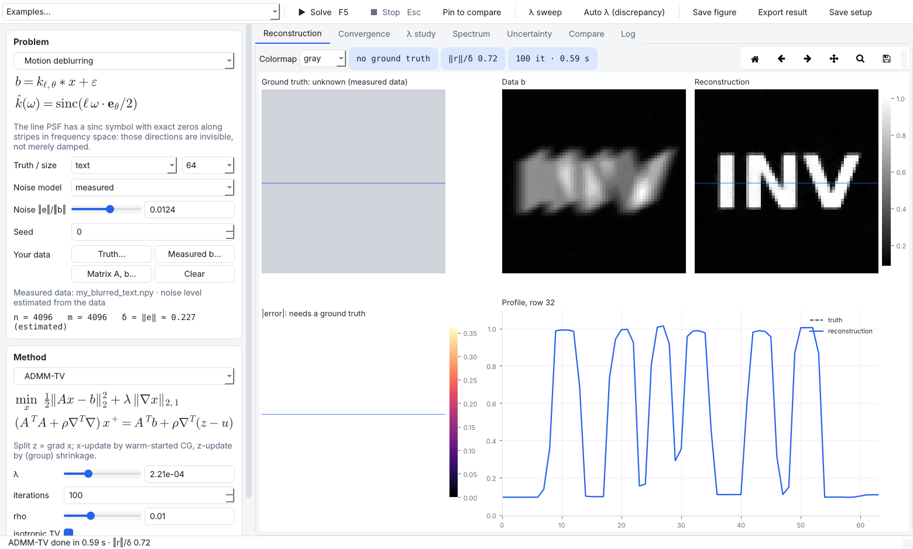

With **Live** on, every edit (including dragging the λ slider) restarts the solve after 140 ms. The
running solve is cancelled, iterates stream into the plots, artists are updated in place, and only the
visible tab redraws. Results computed for an outdated problem or noise draw are thrown away.

The shortcuts are F5 to solve and pin, Esc to stop, Ctrl+L for a λ sweep, Ctrl+P to pin, Ctrl+S to save
the figure, Ctrl+E to export (.npz and .json), and Ctrl+T to switch the theme.

| λ study | Spectrum |
|---|---|
| 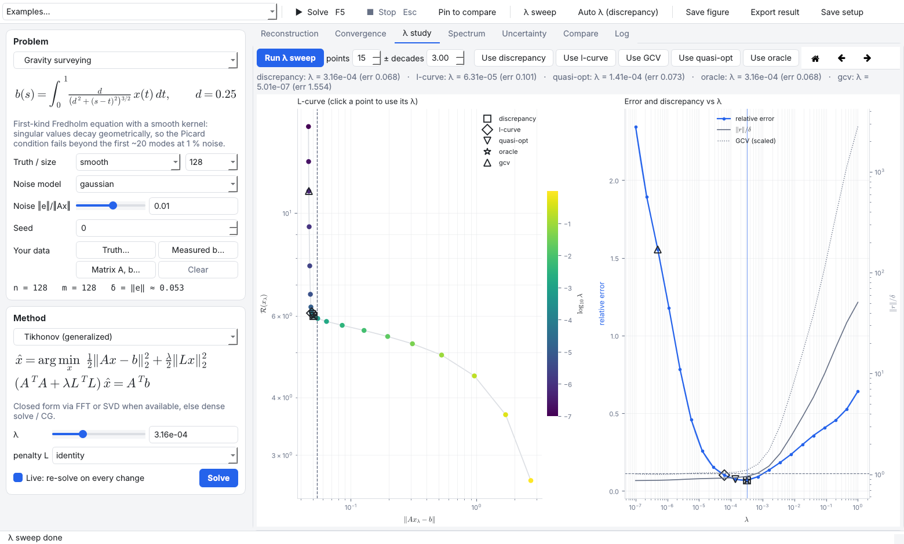 | 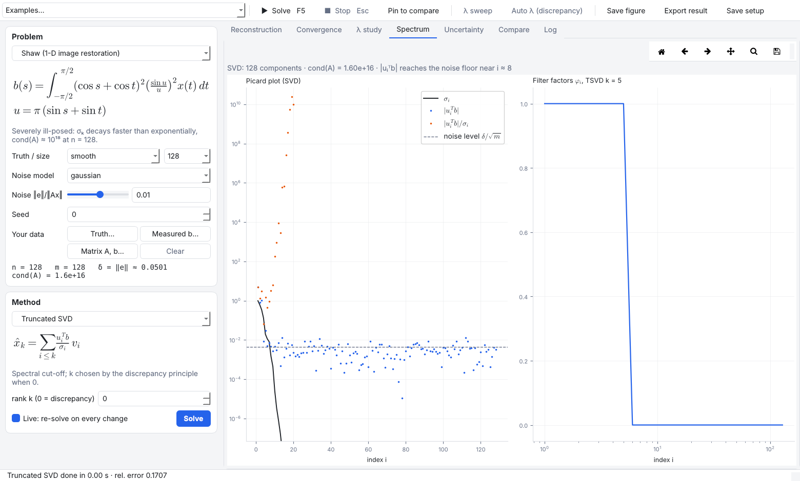 |
| **Uncertainty** | **Compare** |
| 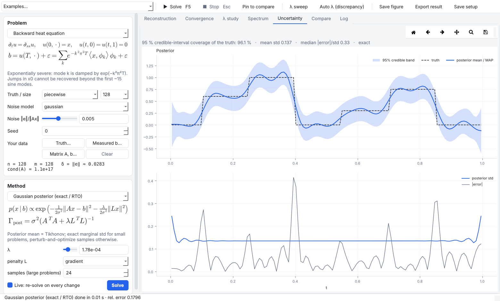 | 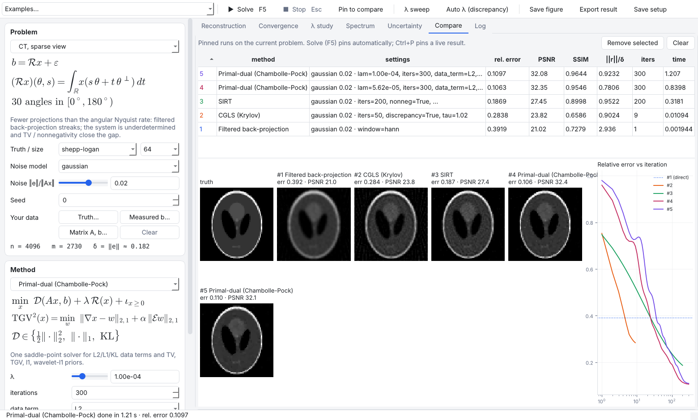 |
| **Dark theme, radial MRI** | **Convergence** |
| 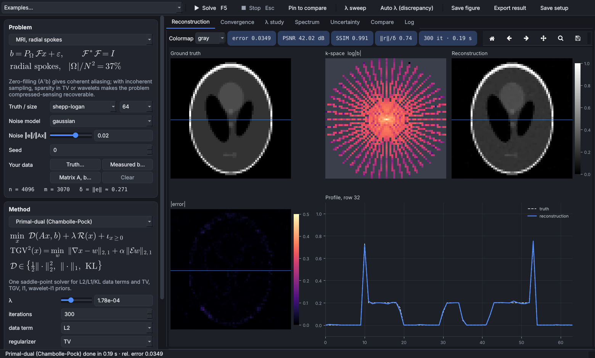 | 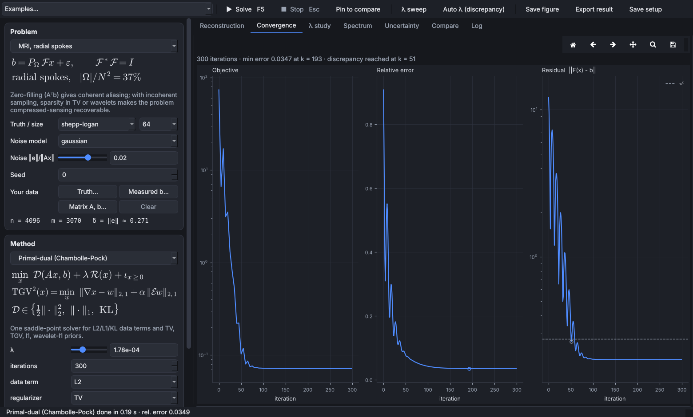 |

## CLI

```bash
invtoolbox list
invtoolbox solve   -p deblur-motion -m admm-tv
invtoolbox solve   -p gravity -m tikhonov --set penalty=gradient --lam discrepancy
invtoolbox solve   -p denoise -m pdhg --noise salt-pepper:0.1 --set data_term=L1 --lam 0.6
invtoolbox compare -p ct-sparse-view -m fbp,cgls,sirt,pdhg --out out/
invtoolbox compare -p compressed-sensing -m all

# your own data
invtoolbox solve   -p deblur-gaussian -m admm-tv --truth-file photo.png
invtoolbox solve   -p deblur-gaussian -m admm-tv --data-file blurred.png --sigma 0.01
invtoolbox compare --matrix A.npy --data-file b.csv -m tikhonov,cgls,fista --lam discrepancy --shape 64,64
```

1. `--lam` takes a number or a rule: `discrepancy`, `l-curve`, `gcv`, `quasi-opt` or `oracle`.
2. `--set key=value` sets any method parameter and can be repeated.
3. `--truth-file`, `--data-file`, `--sigma`, `--matrix` and `--shape` bring in your own data, as described
   under Features.
4. `--out` writes a figure, `results.json` and the reconstructions as `.npy`.

## Library use

```python
import invtoolbox as it

p = it.build("ct-sparse-view", size=96)
d = p.simulate("gaussian", 0.02, seed=1)
r = it.run("pdhg", p, d, {"reg": "TGV2", "lam": 1e-4})
print(r.info["rel_err"], r.info["ssim"])

sw = it.sweep("tikhonov", p, d, {"penalty": "gradient"})
lam = sw["lam"][sw["choices"]["discrepancy"]]

# your own data
from invtoolbox.core import userdata as ud
q = ud.with_truth(it.build("deblur-motion"), ud.load_array("photo.png"))
q, dq = ud.with_measured(it.build("deblur-gaussian"), ud.load_array("blurred.npy"), sigma=0.01)
c, dc = ud.custom_problem(ud.load_array("A.npy"), ud.load_array("b.csv"), shape=(64, 64))
r = it.run("admm-tv", q, dq)            # r.info["rel_err"] is NaN: there is no truth
```

To add a problem, build a `LinOp(n, m, mv, rmv)` (or `F` and `J` for a nonlinear model) and a
`Problem`, then `register(...)` it in `core/problems.py`.

## Layout

```
invtoolbox/
├── cli.py
├── core/
│   ├── operators.py     LinOp, convolution (FFT), Radon matrix, Fourier sampling, masks, Grad, SymGrad
│   ├── wavelets.py      orthonormal periodized Haar / db2 / db4, cycle-spinning denoiser
│   ├── phantoms.py      Shepp–Logan, blocks, bumps, text, stars, bar target; 1-D signals
│   ├── problems.py      Problem, noise models, the 20 problems
│   ├── userdata.py      file loading, your truth / measured data / matrix, noise estimates
│   ├── methods.py       the 22 methods with their parameter specs and equations
│   ├── prox.py          proximal maps, FGP TV prox, CG, PnP denoisers
│   ├── spectral.py      SVD / Fourier filters, Picard data, closed-form Tikhonov curves
│   ├── paramchoice.py   λ sweeps, discrepancy, L-curve, GCV, quasi-optimality
│   ├── defaults.py      default λ (lam_defaults.json)
│   ├── metrics.py       relative error, PSNR, SSIM, discrepancy ratio
│   └── plots.py         static figures
├── gui/
│   ├── app.py           main window, worker threads, live solve logic, your-data dialogs
│   ├── views.py         plot tabs (in-place updates), toolbar with the zoom-out limit
│   └── widgets.py       themes, EquationView, LogSlider, ParamForm, GroupedCombo
└── examples/            gallery.py, tune.py
```

## Citations

1. P. C. Hansen, *Discrete Inverse Problems: Insight and Algorithms*. SIAM, 2010.
2. H. W. Engl, M. Hanke and A. Neubauer, *Regularization of Inverse Problems*. Kluwer, 1996.
3. D. L. Donoho and I. M. Johnstone, "Ideal spatial adaptation by wavelet shrinkage," *Biometrika*, 81(3):425–455, 1994.
4. G. Wahba, "Bayesian 'confidence intervals' for the cross-validated smoothing spline," *J. R. Stat. Soc. B*, 45(1):133–150, 1983.
5. V. A. Morozov, "On the solution of functional equations by the method of regularization," *Soviet Math. Dokl.*, 7:414–417, 1966.
6. P. C. Hansen and D. P. O'Leary, "The use of the L-curve in the regularization of discrete ill-posed problems," *SIAM J. Sci. Comput.*, 14(6):1487–1503, 1993.
7. G. H. Golub, M. Heath and G. Wahba, "Generalized cross-validation as a method for choosing a good ridge parameter," *Technometrics*, 21(2):215–223, 1979.
8. F. Bauer and S. Kindermann, "The quasi-optimality criterion for classical inverse problems," *Inverse Problems*, 24(3):035002, 2008.
9. Z. Wang, A. C. Bovik, H. R. Sheikh and E. P. Simoncelli, "Image quality assessment: from error visibility to structural similarity," *IEEE Trans. Image Process.*, 13(4):600–612, 2004.
10. A. C. Kak and M. Slaney, *Principles of Computerized Tomographic Imaging*. IEEE Press, 1988.
11. M. Lustig, D. Donoho and J. M. Pauly, "Sparse MRI: the application of compressed sensing for rapid MR imaging," *Magn. Reson. Med.*, 58(6):1182–1195, 2007.
12. E. J. Candès, J. Romberg and T. Tao, "Robust uncertainty principles: exact signal reconstruction from highly incomplete frequency information," *IEEE Trans. Inf. Theory*, 52(2):489–509, 2006.
13. D. L. Donoho, "Compressed sensing," *IEEE Trans. Inf. Theory*, 52(4):1289–1306, 2006.
14. P. C. Hansen, "Regularization Tools version 4.0 for Matlab 7.3," *Numer. Algorithms*, 46(2):189–194, 2007.
15. C. B. Shaw Jr., "Improvement of the resolution of an instrument by numerical solution of an integral equation," *J. Math. Anal. Appl.*, 37(1):83–112, 1972.
16. E. J. Candès, X. Li and M. Soltanolkotabi, "Phase retrieval via Wirtinger flow: theory and algorithms," *IEEE Trans. Inf. Theory*, 61(4):1985–2007, 2015.
17. L. A. Shepp and B. F. Logan, "The Fourier reconstruction of a head section," *IEEE Trans. Nucl. Sci.*, 21(3):21–43, 1974.
18. A. N. Tikhonov and V. Y. Arsenin, *Solutions of Ill-Posed Problems*. Winston, 1977.
19. L. Landweber, "An iteration formula for Fredholm integral equations of the first kind," *Amer. J. Math.*, 73(3):615–624, 1951.
20. M. R. Hestenes and E. Stiefel, "Methods of conjugate gradients for solving linear systems," *J. Res. Natl. Bur. Stand.*, 49(6):409–436, 1952.
21. P. Gilbert, "Iterative methods for the three-dimensional reconstruction of an object from projections," *J. Theor. Biol.*, 36(1):105–117, 1972.
22. T. Strohmer and R. Vershynin, "A randomized Kaczmarz algorithm with exponential convergence," *J. Fourier Anal. Appl.*, 15(2):262–278, 2009.
23. I. Daubechies, M. Defrise and C. De Mol, "An iterative thresholding algorithm for linear inverse problems with a sparsity constraint," *Comm. Pure Appl. Math.*, 57(11):1413–1457, 2004.
24. A. Beck and M. Teboulle, "A fast iterative shrinkage-thresholding algorithm for linear inverse problems," *SIAM J. Imaging Sci.*, 2(1):183–202, 2009.
25. B. O'Donoghue and E. Candès, "Adaptive restart for accelerated gradient schemes," *Found. Comput. Math.*, 15(3):715–732, 2015.
26. I. Daubechies, *Ten Lectures on Wavelets*. SIAM, 1992.
27. S. Boyd, N. Parikh, E. Chu, B. Peleato and J. Eckstein, "Distributed optimization and statistical learning via the alternating direction method of multipliers," *Found. Trends Mach. Learn.*, 3(1):1–122, 2011.
28. Y. C. Pati, R. Rezaiifar and P. S. Krishnaprasad, "Orthogonal matching pursuit: recursive function approximation with applications to wavelet decomposition," *Proc. 27th Asilomar Conf. Signals, Systems and Computers*, 40–44, 1993.
29. I. Daubechies, R. DeVore, M. Fornasier and C. S. Güntürk, "Iteratively reweighted least squares minimization for sparse recovery," *Comm. Pure Appl. Math.*, 63(1):1–38, 2010.
30. L. I. Rudin, S. Osher and E. Fatemi, "Nonlinear total variation based noise removal algorithms," *Physica D*, 60(1–4):259–268, 1992.
31. A. Chambolle and T. Pock, "A first-order primal-dual algorithm for convex problems with applications to imaging," *J. Math. Imaging Vis.*, 40(1):120–145, 2011.
32. K. Bredies, K. Kunisch and T. Pock, "Total generalized variation," *SIAM J. Imaging Sci.*, 3(3):492–526, 2010.
33. A. Beck and M. Teboulle, "Fast gradient-based algorithms for constrained total variation image denoising and deblurring problems," *IEEE Trans. Image Process.*, 18(11):2419–2434, 2009.
34. W. H. Richardson, "Bayesian-based iterative method of image restoration," *J. Opt. Soc. Am.*, 62(1):55–59, 1972.
35. L. B. Lucy, "An iterative technique for the rectification of observed distributions," *Astron. J.*, 79:745–754, 1974.
36. N. Dey, L. Blanc-Féraud, C. Zimmer, P. Roux, Z. Kam, J.-C. Olivo-Marin and J. Zerubia, "Richardson–Lucy algorithm with total variation regularization for 3D confocal microscope deconvolution," *Microsc. Res. Tech.*, 69(4):260–266, 2006.
37. S. V. Venkatakrishnan, C. A. Bouman and B. Wohlberg, "Plug-and-play priors for model based reconstruction," *IEEE GlobalSIP*, 945–948, 2013.
38. R. R. Coifman and D. L. Donoho, "Translation-invariant de-noising," in *Wavelets and Statistics*, Springer, 125–150, 1995.
39. J. M. Bardsley, A. Solonen, H. Haario and M. Laine, "Randomize-then-optimize: a method for sampling from posterior distributions in nonlinear inverse problems," *SIAM J. Sci. Comput.*, 36(4):A1895–A1910, 2014.
40. A. Durmus, É. Moulines and M. Pereyra, "Efficient Bayesian computation by proximal Markov chain Monte Carlo: when Langevin meets Moreau," *SIAM J. Imaging Sci.*, 11(1):473–506, 2018.
41. J. Kaipio and E. Somersalo, *Statistical and Computational Inverse Problems*. Springer, 2005.
42. D. W. Marquardt, "An algorithm for least-squares estimation of nonlinear parameters," *J. SIAM*, 11(2):431–441, 1963.
43. R. H. Byrd, P. Lu, J. Nocedal and C. Zhu, "A limited memory algorithm for bound constrained optimization," *SIAM J. Sci. Comput.*, 16(5):1190–1208, 1995.
44. G. Wang, G. B. Giannakis and Y. C. Eldar, "Solving systems of random quadratic equations via truncated amplitude flow," *IEEE Trans. Inf. Theory*, 64(2):773–794, 2018.
